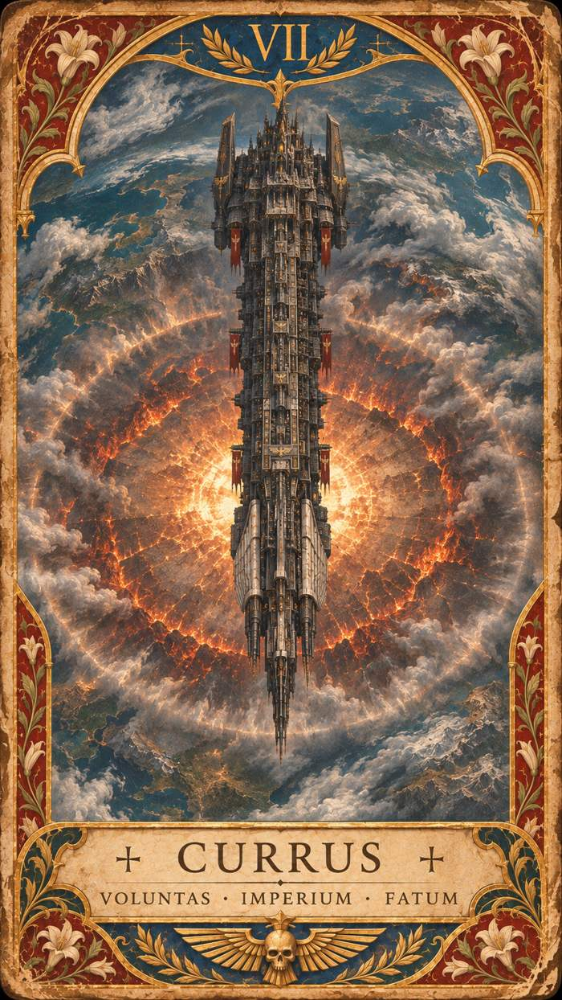
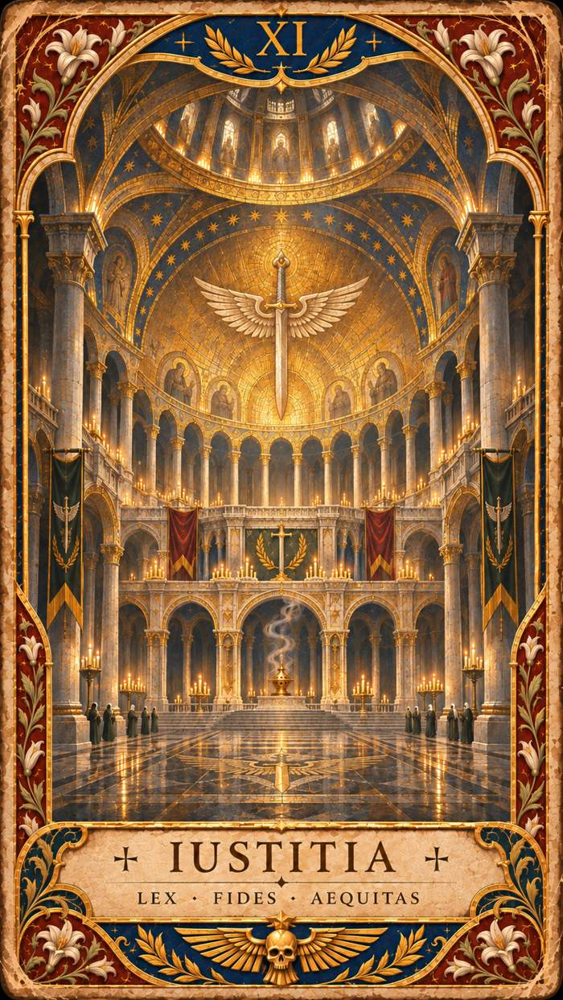
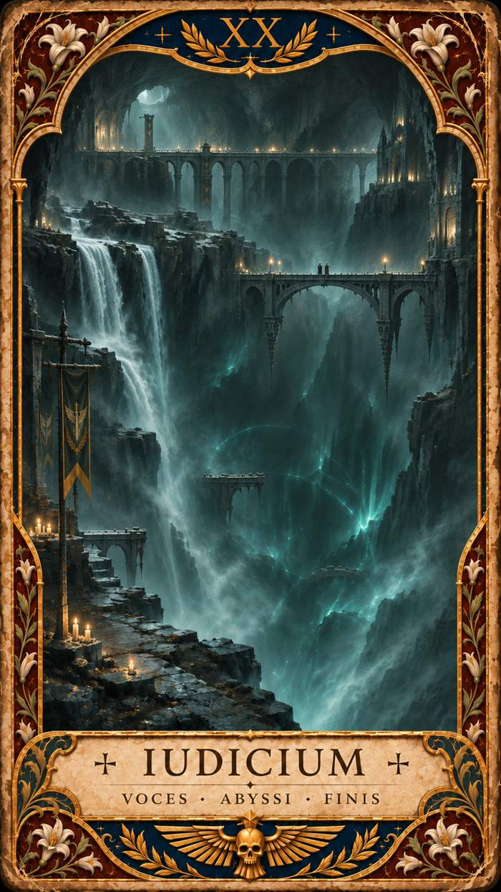

# 残存的希芙拉塔罗

> THE LOST TAROT OF SIOFRA · SIX SURVIVING PLATES

旧藏二十二张大阿卡纳，于567.M34希芙拉井口大裂变中散佚，现存六张。其余十六张的下落未知。567.M34的大裂变与999.M41的银河大裂隙并非同一事件。

以下是图版馆藏记述，并不代替可考战史。每张牌新增的“场景推测”基于图中可见细节及原稿设定，只供理解画面可能呈现的地点与时刻，不作为人物、年代或行动的证明。

## V · PONTIFEX｜教皇 · 旧誓之厅

*SACRAMENTUM · LEX · MEMORIA*

### 图版记述
高耸的肋拱沿厅堂纵深层层收束。左侧整列骑士席位大半空置，深红旧布垂落于石座；右侧的仪礼台、烛火与封存器具与之相对。唯一的披袍行者站在远处中轴前，仿佛正走向尚未被回答的誓问。

### 场景推测〔未证〕
一种解释认为，画面记录的是某次隐修院长继任前的短暂间隙：新任承誓者独自穿过空置的旧骑士席，尚未抵达那张保存异文令状的指挥席。两侧并未排满见证者，烛灯却已按旧例点起。这可以是某一场真实举行的继任礼，也可能是画师把历代继任者所面对的同一问题，画成了一次没有答案的步行；行者身份未见题记。

### 象征释义
这张牌的权威并非来自一名高大的教宗，而来自席位、承诺和无人能轻易废弃的旧制。五条旧誓约束着仍在守望的隐修会，也提醒继任者：空位不能由一纸任命填满。

### 档案附注
薪传议会继承第一军团旧骑士团的承誓席位。原稿记载，继任院长须走过空席，在三份互不一致的令状前作答；图版是否绘于某一任院长的继任礼，暂无可核对的记录。

## VII · CURRUS｜战车 · 余烬号

*VOLUNTAS · IMPERIUM · FATUM*

### 图版记述
暗灰近黑的巨舰沿画面纵轴俯临一颗蛮荒星球。舰体犹如层叠的哥特堡垒，底部的云墙与地表环形熔融区形成强烈明暗对照；画面不描绘发射瞬间，毁灭性的痕迹已经留在地表。

### 场景推测〔未证〕
此牌或许将余烬号早期某次抵达蛮荒行星高轨的景象凝固在命令执行之后：舰船保持寂静，下方地表已留下玻璃化、熔融的巨大环痕，画师刻意略去了武器发射的瞬间。另一种解释认为，这并非对单次行动的写生，而是把远征舰队承担的不可逆命令具象化。早期灭绝令使用纪录已不可考，目标、年代与行动是否确曾发生，均不得由此牌倒推出定论。

### 象征释义
战车象征使命的推行、远征的方向以及命令无法挽回的重量。画中的火环并非胜利庆典，它让执行意志者与被执行的世界处在同一幅无法逃离的图景中。

### 档案附注
余烬号早期使用灭绝令的纪录已不可考。现存图版不足以证明对应的目标星球、行动年代、命令来源，亦不能单凭画面确证一次具体的灭绝令执行；相关推断暂列未证。

## XI · IUSTITIA｜正义 · 金穹之誓

*LEX · FIDES · AEQUITAS*

### 图版记述
层层金色马赛克穹拱覆于圣所上方，飞翼剑徽位于中轴，暗绿与深红的战旗垂向礼拜空间。烛火排列在石廊与台阶边缘；几组披袍者退居厅堂两翼，人物极小，金穹与石质拱券才是画面的真正主体。

### 场景推测〔未证〕
画面可能描绘金穹一次未正式开始的誓词宣读：披袍者已在两翼列定，火烛点亮，中央的飞翼剑徽高悬，但尚无人走向圣匣。若将它与‘证词不可废弃’的旧誓相联系，便像是在一次裁断之前，所有人先面对自己必须遵守的律法。画面没有可辨认的审判对象，也没有可供确认的仪礼日期，因此不宜认定它记录了某次具体判决。

### 象征释义
在这张牌里，正义不是对敌人的宣判，而是对自身律法的约束。礼拜者在悬剑之下保持沉默，呼应隐修会坚持保留证词、拒绝以方便代替审判的旧誓。

### 档案附注
原稿的第五条旧誓规定：未经审判，不得焚毁俘虏供词。金穹与石廊确为希芙拉的重要仪礼空间；画面所示仪式的具体日期、参与者姓名与次序未见可靠登记。

## XVII · STELLAE FALLACES｜星星 · 虚妄星辰

*SPECULUM · FATUM · SPES*

### 图版记述
三颗冷白伪星悬于青蓝色地下穹顶之上；黑河穿过层层哥特石桥，冷光在近乎静止的水面留下不尽相符的倒影。左下角一名披袍观星者以小型黄铜望远镜凝视穹顶，几乎隐没于巨大的地下城市。

### 场景推测〔未证〕
这可能是一班地底观星者在黑河边进行穹顶复测的夜晚：三点伪星仍在原位，水中反光却未完全服从他们熟悉的排列，观测者迟迟没有收起镜筒。它也可能与历次伪星异常后的校准工作有关，而非某场战役的现场。牌面呈现的是‘看见差异’的一刻，并未留下可验证的读数或观测者姓名。

### 象征释义
星星在此并不保证救赎。观测能提供方向，却不能使所见成为真相；希望与误认同时存在，正是隐修会在三伪星与黑河之间长期维持的谨慎。

### 档案附注
三伪星是隐修会多次记录的异常天象。图版中星光与水中反射的细小差异，可以是画师的象征处理；尚不能据此建立一份新的天文测量记录。

## XIX · SOL｜太阳 · 锻造与重生

*IGNIS · FERRUM · RENASCENTIA*

### 图版记述
中央的高温熔炉在哥特工业拱穹深处燃烧，轨道矿车从左侧掘进区驶入，起重架、浇铸槽和维修平台延向右方。一台严重残损的帝国骑士机甲仍被支架托住，护甲缺失，内部结构暴露；工人只是平台上的细小剪影。

### 场景推测〔未证〕
此图或许描绘一座仍在运转的机械教地下铸造工区：矿石由左侧窄轨进入，中央炉心熔炼材料，右侧维修架正试图扶起一台尚未恢复行走能力的帝国骑士。由挖掘到铸造、再到修复，整处空间像被同一次工作班次连接。图中没有任何足以确定铸造世界、骑士家族或修复年份的标记；残骸更不能据此归入一场具体战役。

### 象征释义
太阳不是完整无缺的凯旋，而是炉心尚热、制造仍能继续。余烬照亮损坏的机体与未完成的修复，使延续生命和重建秩序成为画面的希望。

### 档案附注
此图将机械教的矿业、冶炼与制造意象并置。现存记录不足以确认图中的骑士机甲型号、所属家族或特定修复工程；不得将其误写为某次已证实的战役后勤纪录。

## XX · IUDICIUM｜审判 · 深渊之数

*VOCES · ABYSSI · FINIS*

### 图版记述
高处的石桥与廊道保持水平，横跨两侧不规则的天然岩壁；一道巨瀑从左侧断崖落下，在深处逐渐被黑暗与水雾吞没。极小的守望者停在桥上，深渊内的青蓝色微光并不形成规则圆环，更像遥远回声短暂经过。

### 场景推测〔未证〕
一种较谨慎的推测是：此牌画的是大裂变之后，守望者从横跨天然裂谷的桥廊重新确认井口边界的一次值夜。瀑布继续落入没有底部标记的黑暗，灯火与桥身尚在，青蓝色异常微光却似乎从更深处传来。若把那片微光读作‘深渊之数’的视觉化表现，便是在描绘听见计数而无法判明来源的瞬间；但这并不能证明画作一定创作于567.M34之后。

### 象征释义
审判不是一名审判者的显现，而是世界已听见某个接近终点的计数。桥梁依旧可通行，瀑布仍在下落，唯独井底的声音在迫使守望者重新思考他们等待的终局。

### 档案附注
原稿记载，567.M34 大裂变之后，井底首次传出清晰计数声，后来被命名为“深渊之数”。图版与该现象的关联可作释义，但画作的原始绘制年代并未证实。

---

*馆藏编目补记：只陈列六张残存图版；其他十六张不以现代补绘顶替。*
