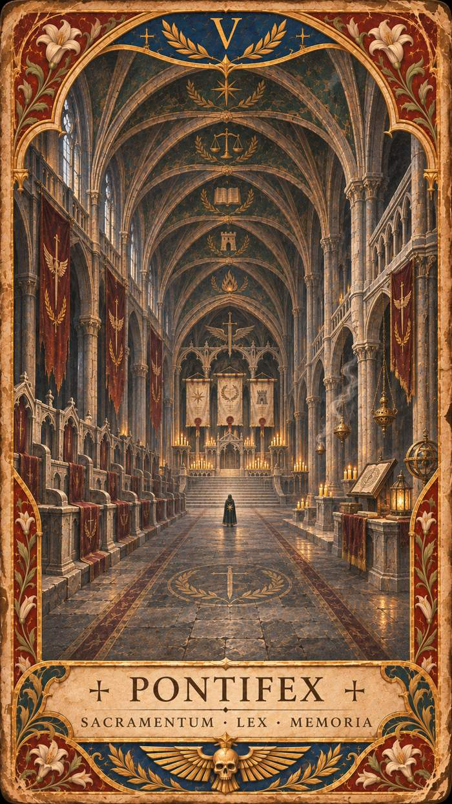
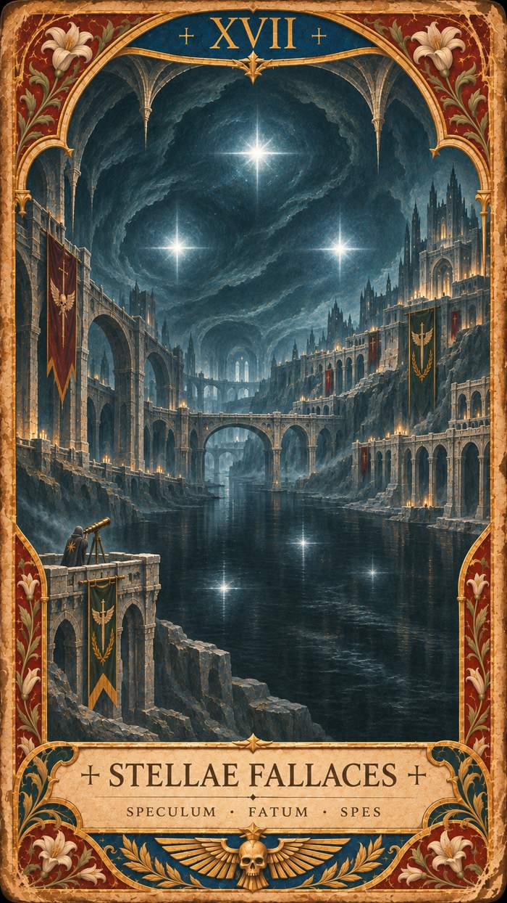
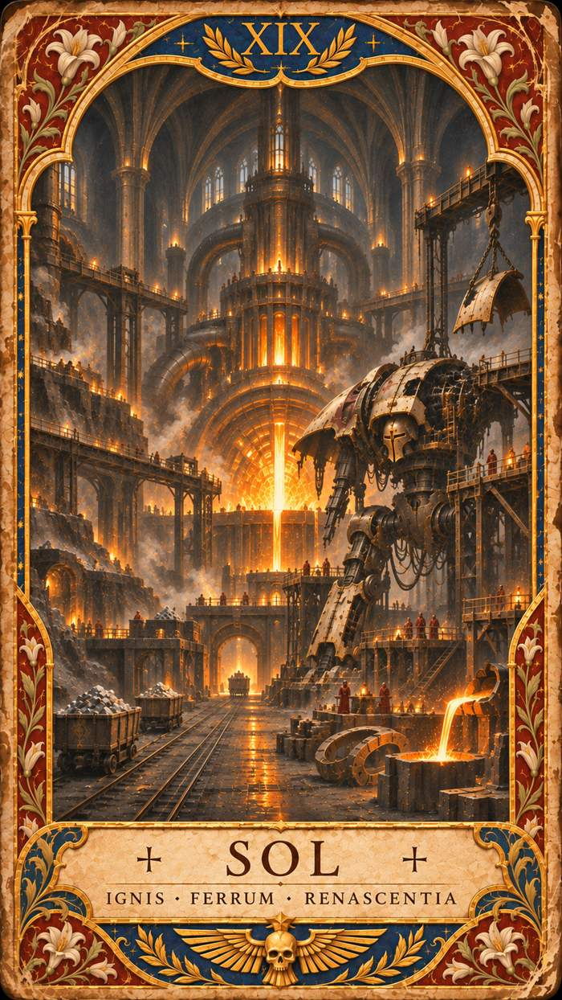

# 残存的希芙拉塔罗

> THE LOST TAROT OF SIOFRA · SIX SURVIVING PLATES

旧藏二十二张大阿卡纳，于567.M34希芙拉井口大裂变中散佚，现存六张。其余十六张的下落未知。567.M34的大裂变与999.M41的银河大裂隙并非同一事件。

以下是图版馆藏记述，并不代替可考战史。

## V · PONTIFEX｜教皇 · 旧誓之厅

*SACRAMENTUM · LEX · MEMORIA*

### 图版记述
高耸的肋拱沿厅堂纵深层层收束。左侧整列骑士席位大半空置，深红旧布垂落于石座；右侧的仪礼台、烛火与封存器具与之相对。唯一的披袍行者站在远处中轴前，仿佛正走向尚未被回答的誓问。

### 象征释义
这张牌的权威并非来自一名高大的教宗，而来自席位、承诺和无人能轻易废弃的旧制。五条旧誓约束着仍在守望的隐修会，也提醒继任者：空位不能由一纸任命填满。

### 档案附注
薪传议会继承第一军团旧骑士团的承誓席位。原稿记载，继任院长须走过空席，在三份互不一致的令状前作答；图版是否绘于某一任院长的继任礼，暂无可核对的记录。

## VII · CURRUS｜战车 · 余烬号

*VOLUNTAS · IMPERIUM · FATUM*

### 图版记述
暗灰近黑的巨舰沿画面纵轴俯临一颗蛮荒星球。舰体犹如层叠的哥特堡垒，底部的云墙与地表环形熔融区形成强烈明暗对照；画面不描绘发射瞬间，毁灭性的痕迹已经留在地表。

### 象征释义
战车象征使命的推行、远征的方向以及命令无法挽回的重量。画中的火环并非胜利庆典，它让执行意志者与被执行的世界处在同一幅无法逃离的图景中。

### 档案附注
余烬号早期使用灭绝令的纪录已不可考。现存图版不足以证明对应的目标星球、行动年代、命令来源，亦不能单凭画面确证一次具体的灭绝令执行；相关推断暂列未证。

## XI · IUSTITIA｜正义 · 金穹之誓

*LEX · FIDES · AEQUITAS*

### 图版记述
层层金色马赛克穹拱覆于圣所上方，飞翼剑徽位于中轴，暗绿与深红的战旗垂向礼拜空间。烛火排列在石廊与台阶边缘；几组披袍者退居厅堂两翼，人物极小，金穹与石质拱券才是画面的真正主体。

### 象征释义
在这张牌里，正义不是对敌人的宣判，而是对自身律法的约束。礼拜者在悬剑之下保持沉默，呼应隐修会坚持保留证词、拒绝以方便代替审判的旧誓。

### 档案附注
原稿的第五条旧誓规定：未经审判，不得焚毁俘虏供词。金穹与石廊确为希芙拉的重要仪礼空间；画面所示仪式的具体日期、参与者姓名与次序未见可靠登记。

## XVII · STELLAE FALLACES｜星星 · 虚妄星辰

*SPECULUM · FATUM · SPES*

### 图版记述
三颗冷白伪星悬于青蓝色地下穹顶之上；黑河穿过层层哥特石桥，冷光在近乎静止的水面留下不尽相符的倒影。左下角一名披袍观星者以小型黄铜望远镜凝视穹顶，几乎隐没于巨大的地下城市。

### 象征释义
星星在此并不保证救赎。观测能提供方向，却不能使所见成为真相；希望与误认同时存在，正是隐修会在三伪星与黑河之间长期维持的谨慎。

### 档案附注
三伪星是隐修会多次记录的异常天象。图版中星光与水中反射的细小差异，可以是画师的象征处理；尚不能据此建立一份新的天文测量记录。

## XIX · SOL｜太阳 · 锻造与重生

*IGNIS · FERRUM · RENASCENTIA*

### 图版记述
中央的高温熔炉在哥特工业拱穹深处燃烧，轨道矿车从左侧掘进区驶入，起重架、浇铸槽和维修平台延向右方。一台严重残损的帝国骑士机甲仍被支架托住，护甲缺失，内部结构暴露；工人只是平台上的细小剪影。

### 象征释义
太阳不是完整无缺的凯旋，而是炉心尚热、制造仍能继续。余烬照亮损坏的机体与未完成的修复，使延续生命和重建秩序成为画面的希望。

### 档案附注
此图将机械教的矿业、冶炼与制造意象并置。现存记录不足以确认图中的骑士机甲型号、所属家族或特定修复工程；不得将其误写为某次已证实的战役后勤纪录。

## XX · IUDICIUM｜审判 · 深渊之数

*VOCES · ABYSSI · FINIS*

### 图版记述
高处的石桥与廊道保持水平，横跨两侧不规则的天然岩壁；一道巨瀑从左侧断崖落下，在深处逐渐被黑暗与水雾吞没。极小的守望者停在桥上，深渊内的青蓝色微光并不形成规则圆环，更像遥远回声短暂经过。

### 象征释义
审判不是一名审判者的显现，而是世界已听见某个接近终点的计数。桥梁依旧可通行，瀑布仍在下落，唯独井底的声音在迫使守望者重新思考他们等待的终局。

### 档案附注
原稿记载，567.M34 大裂变之后，井底首次传出清晰计数声，后来被命名为“深渊之数”。图版与该现象的关联可作释义，但画作的原始绘制年代并未证实。

---

*馆藏编目补记：只陈列六张残存图版；其他十六张不以现代补绘顶替。*
